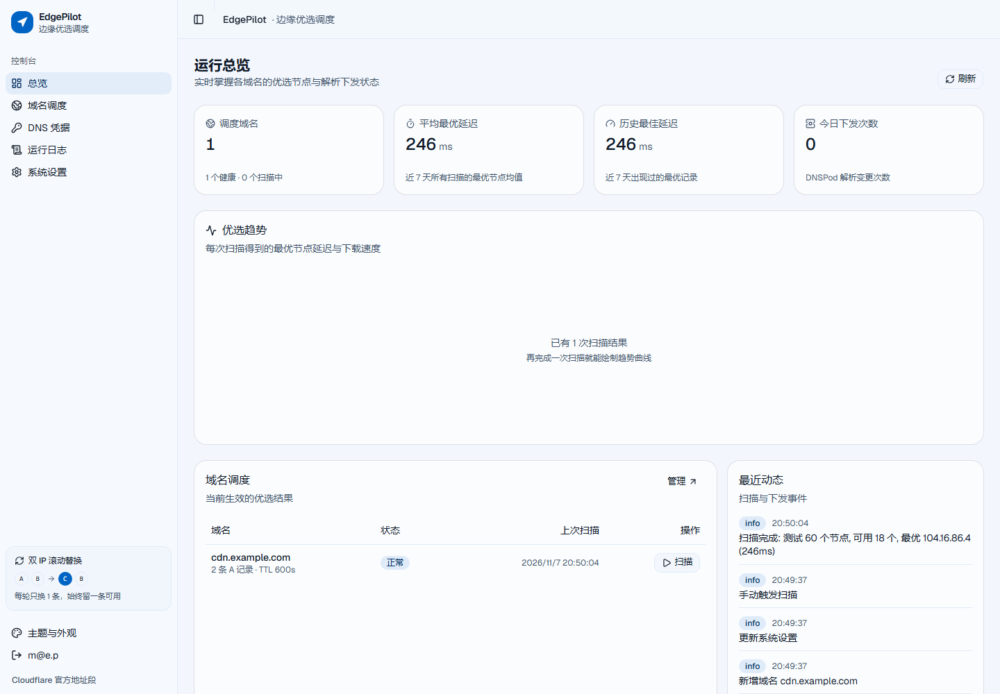
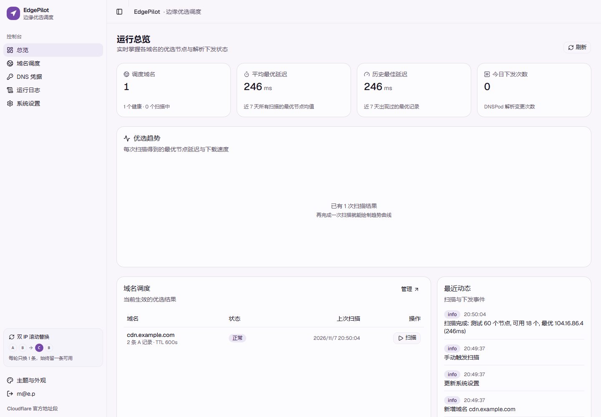
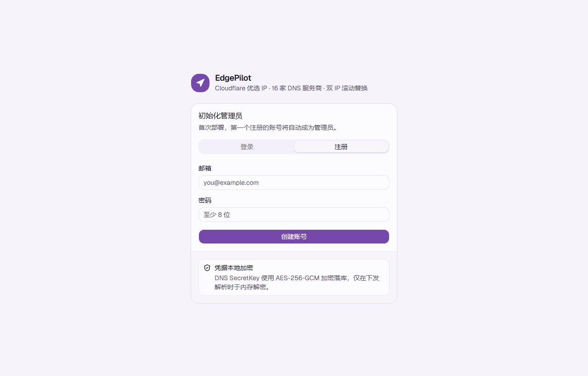
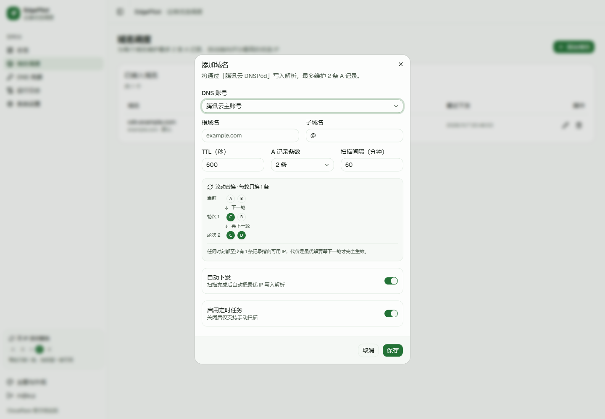

# EdgePilot · 边缘领航

**Cloudflare 优选 IP 调度平台** —— 持续测速挑出最快的边缘 IP，自动写进你的 DNS 解析。

EdgePilot 面向国内访问 Cloudflare 的场景：定时对边缘节点做延迟 / 丢包 / 下载测速，按加权评分选出最优 IP，再通过 DNS 服务商 API 自动切换解析。前端 React 19 + shadcn/ui（base-nova 预设，全部使用官方 registry 组件），后端 Go 单二进制（内嵌前端），数据存 SQLite，部署一个文件即可跑起来。DNS 侧内置 **16 家服务商**，腾讯云、阿里云、Cloudflare、华为云、GoDaddy 等都能直接用。


---

## 为什么需要它

Cloudflare 的 anycast 网络里，**任何一个边缘 IP 都能到达你的站点**，但从你所在运营商出发，不同 IP 的路由质量能差出 3～10 倍。社区所谓的「优选 IP」，就是持续测量、挑出当前最快的那些 IP 写进解析。

本项目把这套手工流程产品化：

| 手工做法 | 本平台 |
| --- | --- |
| 下载第三方测速工具，手动扫 | 定时自动扫描，结果入库、可视化 |
| 扫完手动去 DNS 面板改记录 | 自动写入 DNS，带审计日志 |
| 改错了把两条记录一起改挂 | 滚动替换：一次最多换一条，永远留一条可用 |
| 换台机器就没了 | 多用户 SaaS，凭据加密落库，跨设备可用 |

## 核心能力

- **三段式优选**：TCP 握手延迟（含抖动 / 丢包）→ `/cdn-cgi/trace` 校验真实可用与机房 → 下载测速，最后加权评分排名
- **16 家 DNS 服务商**：统一抽象为「读记录 / 建记录 / 改记录 / 删记录 / 校验凭据」五个动作，新增厂商只需实现一个接口
- **双 IP 滚动替换**：适配「同一主机记录只允许两条 A 记录」的限制，每次下发最多替换一条，永远保留一条可用
- **故障自愈**：每 3 分钟探测当前生效 IP，全部不可达时立即触发紧急重扫
- **实时进度**：SSE 推送扫描阶段与进度，前端进度条不刷新即可更新
- **安全边界**：只接管自己创建的记录（备注标记 + 本地账本双保险），手写记录永不被动
- **多租户**：账号隔离，首个注册用户自动成为管理员；凭据使用 AES-256-GCM 加密存储
- **完整留痕**：扫描开始 / 阶段切换 / 完成耗时、下发变更、健康巡检、接口异常全部落库，控制台与页面一致，支持按级别筛选与关键字搜索
- **凭据可编辑**：换密钥或改备注直接编辑，不必删除账号（删除会级联清掉域名配置）
- **主题化界面**：7 套 Material Design 3 配色 × 明暗模式，默认翡翠，左下角随时切换
- **统一请求层**：所有接口走同一个封装 —— 顶部进度条、401 自动登出、超时兜底、错误提示全局生效
- **移动端适配**：窄屏下侧边栏自动收成抽屉，表格按优先级隐藏次要列，指标卡自动折行

## 外观与主题

配色参照 Material Design 3：每套主题只声明 4 个种子色（primary / secondary / tertiary / error），
其余 surface、border、文本色全部由 `color-mix()` 从种子派生 —— 浅色面是主色与白色的低比例混合，
深色面是主色混入近黑，这正是 MD3 的 tonal surface 思路。换主题只改 4 个变量，整套界面自动跟着走，
不需要为每个组件写一遍配色。

内置 7 套配色 × 明暗两种模式，**默认翡翠**，左下角「主题与外观」随时切换，选择记在浏览器本地：

翡翠（默认） · 紫罗兰 · 天青 · 青碧 · 琥珀 · 玫红 · 石墨


| 天青 | 紫罗兰 |
| --- | --- |
|  |  |

深色模式同样跟随主题种子色：


## 支持的 DNS 服务商

| 服务商 | 标识 | 凭据 | A 记录上限 | 写入方式 |
| --- | --- | --- | --- | --- |
| 腾讯云 DNSPod | `dnspod` | SecretId / SecretKey | 2 | 逐记录 |
| 阿里云云解析 | `aliyun` | AccessKey ID / Secret | 2 | 逐记录 |
| Cloudflare | `cloudflare` | API Token | 2 | 逐记录（自动开启橙云代理） |
| 华为云云解析 | `huawei` | AK / SK | 2 | 整组覆盖（RRset） |
| 百度智能云 DNS | `baidu` | AK / SK | 2 | 逐记录 |
| GoDaddy | `godaddy` | API Key / Secret | 2 | 整组覆盖 |
| Porkbun | `porkbun` | API Key / Secret | 2 | 逐记录 |
| NameSilo | `namesilo` | API Key | 2 | 逐记录 |
| ClouDNS | `cloudns` | Auth ID / Password | 2 | 逐记录 |
| deSEC | `desec` | API Token | 2 | 整组覆盖（RRset） |
| NS1 | `nsone` | API Key | 2 | 整组覆盖 |
| Gcore DNS | `gcore` | API Token | 2 | 整组覆盖（RRset） |
| Vercel DNS | `vercel` | API Token | 2 | 逐记录 |
| Name.com | `namecom` | 用户名 / API Token | 2 | 逐记录 |
| Spaceship | `spaceship` | API Key / Secret | 2 | 整组覆盖（读改写） |
| 自定义 Webhook | `callback` | 回调地址 / Token | 1 | 纯推送 |

> **逐记录**：每条 A 记录有独立 ID，可以精确地只改一条，滚动替换最彻底。
> **整组覆盖**：厂商 API 以「记录集」为单位（一个主机名 + A 类型只有一个对象，里面放多个值），平台会读回整组、只替换其中一个值再整体写回，滚动替换依然成立。

新增厂商只要在 `backend/internal/dnsprovider/` 放一个文件：实现 5 个方法 + 一段 `Register(...)` 声明字段，前端表单会自动出现，不需要改任何 UI 代码。

## 架构

```
┌──────────────────────────────────────────────────────────┐
│  React 19 + shadcn/ui (base-nova)  ← 打包进 Go 二进制     │
└───────────────────────────┬──────────────────────────────┘
                            │ REST + SSE
┌───────────────────────────▼──────────────────────────────┐
│  Go HTTP 层（net/http 路由）                              │
│    ├── 鉴权 JWT / 限流                                    │
│    ├── 域名 / 凭据 / 任务 CRUD                            │
│    └── SSE Hub（按域名广播扫描进度）                      │
├──────────────────────────────────────────────────────────┤
│  调度器  ──  到期扫描 / 健康巡检 / 紧急重扫                │
├──────────────────────────────────────────────────────────┤
│  扫描引擎  ──  采样 → TCP 探测 → 边缘校验 → 下载测速 → 评分 │
├──────────────────────────────────────────────────────────┤
│  DNS 抽象层  ──  16 家 Provider 注册表（逐记录 / 整组覆盖） │
├──────────────────────────────────────────────────────────┤
│  SQLite（WAL）  ──  用户 / 凭据 / 域名 / 任务 / 结果 / 日志 │
└──────────────────────────────────────────────────────────┘
```

## 快速开始

### 方式一：Docker Compose（推荐）

```bash
git clone <repo> cf-ip-optimizer && cd cf-ip-optimizer
cp .env.example .env
# 编辑 .env：PILOT_DOMAIN / ACME_EMAIL / PILOT_SECRET（openssl rand -hex 32）

docker compose up -d --build
```

Caddy 会自动申请 Let's Encrypt 证书并反代，`https://你的面板域名` 打开即可。首次访问会引导你注册管理员账号。



> `PILOT_SECRET` 一旦确定就不要再改：它同时用于签发登录令牌和加密 DNS 凭据，变更后旧凭据需要重新录入。

### 方式二：单二进制

```bash
# 构建（需要 Go 1.27+ 与 Node 20+）
cd web && npm ci && npm run build && cd ..
cd backend && CGO_ENABLED=0 go build -trimpath -ldflags "-s -w" -o ../dist/edgepilot .

# 运行
PILOT_ADDR=:8080 PILOT_DATA_DIR=/opt/edgepilot/data PILOT_SECRET=$(openssl rand -hex 32) ./dist/edgepilot
```

二进制内嵌前端，不需要额外的 Nginx/静态目录。反向代理注意给 SSE 关闭缓冲（Nginx：`proxy_buffering off;`；Caddy：`flush_interval -1`）。

systemd 用户可直接使用 [`deploy/edgepilot.service`](deploy/edgepilot.service)。

### 方式三：本地开发

```bash
# 终端 1：后端
cd backend && go run .            # :8080

# 终端 2：前端（Vite 已配置 /api 代理到 :8080）
cd web && npm run dev             # :5173
```

## 使用流程

1. **注册**：第一个账号自动成为管理员；之后可在「系统设置 → 开放注册」控制是否允许自助注册。
2. **添加 DNS 凭据**：「DNS 凭据 → 添加账号」，选服务商，按提示填凭据，点「测试连接」验证。建议使用仅授权目标域名解析的最小权限子账号。
3. **添加域名**：填根域名、子域名、TTL、A 记录条数、扫描间隔、是否自动下发。保存后**立即触发首次扫描**，不用等调度周期；条数上限由服务商能力自动限制。
4. **扫描**：点「立即扫描」，页面实时显示阶段与进度；扫描结束后自动下发（如开启）。
5. **验证**：在「当前生效记录」里能看到槽位与最近下发时间，「当前解析」页签显示服务商上的实时记录。

## 前置条件（重要）

本平台只负责「测速 + 写 A 记录」，两端的准备需要你自己完成：

**Cloudflare 侧**
- 该主机名必须已经由 Cloudflare 提供服务（常规接入 / CNAME 接入 / Cloudflare for SaaS 自定义主机名均可），否则把 A 记录指向 CF 边缘 IP 只会得到 403。
- 扫描时会用**你的域名**作为 SNI 去握手，因此证书必须已签发；`/cdn-cgi/trace` 能返回 `colo` 说明链路正常。

**DNS 侧**
- 域名的 NS 托管在你选择的服务商上，且账号有该域名的解析读写权限。
- 腾讯云同一主机记录最多两条 A 记录（负载均衡限制），所以平台默认 `slots=2`；其他厂商同样受各自 API 约束，超限会在保存时直接拒绝。
- 平台创建的记录会带备注标记，本地数据库另有一份「记录 ID → 槽位」账本；两者任一存在即认为是自己的记录，其余记录（你手工加的）永远不会被修改或删除。

## 优选算法

```
阶段 1  采样      按地址段大小加权，从 Cloudflare 官方 IPv4/IPv6 段中随机取 N 个地址
阶段 2  延迟探测  每个地址 3 次 TCP 握手，取平均值、极差（抖动）、失败率（丢包）
阶段 3  边缘校验  对延迟最好的 3N 个地址请求 /cdn-cgi/trace，验证真的能提供服务并拿到机房代码
阶段 4  下载测速  对 Top N 拉取固定字节数，换算 Mbps
阶段 5  评分      见下
```

评分（0～100）：

```
latencyScore = clamp(1 - (latency - 10) / 490)      // 10ms 满分，500ms 归零
speedScore   = clamp(speed / 50)                     // 50Mbps 满分
lossScore    = 1 - loss

有下载数据：score = 100 × (0.45·latency + 0.30·speed + 0.25·loss)
无下载数据：score = 100 × (0.65·latency + 0.35·loss) × 0.92   // 不越过已测速的节点
```

权重刻意偏向延迟：优选 IP 的主要收益来自 RTT，带宽只在首屏大资源时才有感知。

参数可在「系统设置」里调，默认 300 候选 / 48 并发 / 1200ms 超时 / 12 个测速节点。

## 双 IP 滚动替换

假设当前解析是 `[A, B]`，本次最优是 `[C, D]`，开启滚动替换时：

```
当前     [A] [B]
            ↓ 每轮只换 1 条
轮次 1   [C] [B]      ← 只改槽位 1
            ↓
轮次 2   [C] [D]      ← 只改槽位 2
```

任何时刻都至少有 1 条记录指向可用 IP，代价是最优解要等 1 个扫描周期才完全生效。关掉该项则一次替换到位（收敛更快，但两条同时失效时会有短暂全站不可用）。



两个细节：

- 如果目标 IP 已经在另一条记录上（只是槽位顺序不同），平台只在本地重排槽位映射，**不会发起任何 API 调用** —— 省调用量，也避免无意义的 TTL 缓存刷新。
- 整组覆盖式厂商（华为云 / deSEC / Gcore / NS1 / GoDaddy / Spaceship）同样支持滚动：平台读回整组，只替换其中一个值，再整体写回。

## 配置项

| 环境变量 | 默认值 | 说明 |
| --- | --- | --- |
| `PILOT_ADDR` | `:8080` | 监听地址 |
| `PILOT_DATA_DIR` | `./data` | 数据目录（SQLite + 密钥文件），**不会写入用户目录** |
| `PILOT_SECRET` | 自动生成并存到 `data/secret.key` | JWT 与凭据加密密钥 |
| `PILOT_BASE_URL` | 空 | 对外地址，用于决定 Cookie 是否加 `Secure` |
| `PILOT_TRUST_PROXY` | `false` | 位于反代之后时开启，取 `X-Forwarded-For` |
| `PILOT_LOG_LEVEL` | `info` | 日志级别 |

## API 速览

所有 `/api/*`（除 `health`、`config`、`auth/login|register`）都需要 `Authorization: Bearer <token>`。

```
POST   /api/auth/login            登录
GET    /api/providers             服务商列表与凭据字段定义（前端表单据此渲染）
POST   /api/accounts              新增 DNS 账号（credentials 为键值对）
POST   /api/accounts/test         校验凭据
GET    /api/domains               域名列表
POST   /api/domains/{id}/scan     触发扫描
POST   /api/domains/{id}/push     用最近一次结果下发
GET    /api/domains/{id}/records  服务商上的实时记录
GET    /api/jobs/{id}/export.csv  导出测速结果
GET    /api/stream?domainId=1     SSE 扫描进度
GET    /api/overview              总览数据
```

## 安全说明

- 密码 bcrypt，登录失败 10 次 / 10 分钟限流
- DNS 凭据整包 JSON 用 AES-256-GCM（密钥由 `PILOT_SECRET` 派生）加密后入库，只在写解析时于内存解密
- 账号列表只回显掩码后的标识（如 `AKID••••1a2b`），不返回任何原始密钥
- 仅接管自己创建的 DNS 记录，绝不触碰手工记录

## 排错

| 现象 | 原因与处理 |
| --- | --- |
| 扫描结果里下载速度全是 `—` | 服务器到 `speed.cloudflare.com` 的 TLS 被拦（企业网关 / 受限网络）。延迟排名依然有效，可忽略 |
| `AuthFailure.SignatureFailure`（腾讯云） | `SecretKey` 填错，或服务器时间与标准时间偏差超过 5 分钟 |
| `Invalid request headers`（Cloudflare） | Token 无效或缺少 Zone.DNS 编辑权限 |
| 保存域名提示「最多支持 N 条」 | 该服务商 API 限制，把 A 记录条数调小即可 |
| 页面一直「扫描中」 | SSE 被反代缓冲，检查 `flush_interval -1` / `proxy_buffering off` |
| 解析改了但站点没变化 | 本地 DNS 缓存，等 TTL 过期；TTL 建议 600s |
| 升级后旧账号提示缺少凭据 | 早期版本只支持 DNSPod 的固定字段，升级为多服务商后请重新添加一次账号 |

## 目录结构

```
.
├── backend/                       Go 服务
│   ├── cmd/probe/                 单 IP 分阶段计时诊断工具
│   ├── internal/
│   │   ├── dnsprovider/           服务商注册表 + 16 家实现 + 记录同步
│   │   ├── scanner/               采样 / 探测 / 测速 / 评分 / SSE Hub
│   │   ├── scheduler/             定时扫描与健康巡检
│   │   ├── service/               业务编排（扫描 → 下发）
│   │   ├── httpapi/               路由与处理器
│   │   ├── store/                 SQLite 持久层
│   │   └── auth/ cryptox/         鉴权与加密
│   └── web/                       内嵌前端产物
├── web/                           React + shadcn/ui（base-nova）
├── deploy/                        Caddyfile / systemd
└── Dockerfile docker-compose.yml
```

## License

MIT
