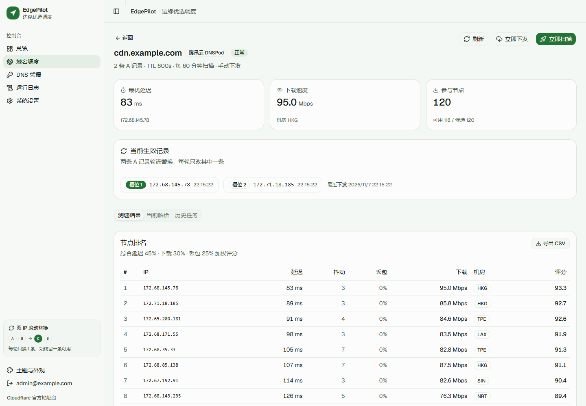

# EdgePilot · 边缘领航

给 Cloudflare 站点挑最快的边缘 IP，挑完自动改 DNS，装一个二进制就能跑


---

## 这东西解决什么问题

Cloudflare 的 anycast 网络里，**任何一个边缘 IP 都能打开你的站**，但从国内出发，不同 IP 的路由质量能差三到十倍，同一个域名换个 IP 可能从 300ms 掉到 60ms

社区的做法是拿测速工具扫一遍，挑几个快的，手动去 DNS 面板改 A 记录，问题是 IP 会劣化，今天快的下个月就慢，没人天天手动扫

EdgePilot 把这套流程做成常驻服务：定时测速 → 按延迟、速度、丢包打分 → 把最优的两个 IP 写进你的 DNS，你只管看结果

## 三分钟跑起来

```bash
git clone https://github.com/whohhnb/cf-ip-optimizer && cd cf-ip-optimizer
cp .env.example .env      # 填 PILOT_DOMAIN、ACME_EMAIL、PILOT_SECRET
docker compose up -d --build
```

打开 `https://你的域名`，第一个注册的账号自动成为管理员，然后按顺序做三件事：**加 DNS 凭据 → 加域名 → 等它扫完**


不想用 Docker 的话，[Release](https://github.com/whohhnb/cf-ip-optimizer/releases) 里有 linux、macOS、Windows 的预编译包，解压即用

## 它做了什么

- **三段式测速**：先 TCP 握手测延迟和丢包（便宜，能扫几百个），再对最快的几十个做 `/cdn-cgi/trace` 验证和下载测速（贵，但准），不拿带宽去测一堆注定不合格的 IP
- **双 IP 滚动替换**：当前 `[A, B]`、最优 `[C, D]` 时一轮只改一条，`[C, B]` → `[C, D]`，任何时刻都有一条记录指向可用 IP，代价是最优解晚一个周期生效
- **故障自愈**：每三分钟探一次当前生效的 IP，全挂就立刻重扫，不等定时任务
- **只动自己的记录**：平台创建的记录带备注标记，本地还有一份「记录 ID → 槽位」账本，双重确认，你手写的 A 记录永远不会被碰
- **16 家 DNS 服务商**：腾讯云、阿里云、华为云、百度智能云、Cloudflare、GoDaddy、Porkbun、NameSilo、ClouDNS、deSEC、NS1、Gcore、Vercel、Name.com、Spaceship，外加一个自定义 Webhook 兜底

> 加新厂商只要在 `backend/internal/dnsprovider/` 放一个文件，实现五个方法加一段 `Register()` 声明字段，前端表单自动出现，UI 一行都不用改

## 它是怎么挑 IP 的

```
采样     从 Cloudflare 官方段里按大小加权随机取 300 个地址
延迟     每个地址 3 次 TCP 握手，得到均值、抖动、丢包率
验证     对最快的 36 个请求 /cdn-cgi/trace，确认真能服务，顺便拿到机房代码
测速     对前 12 个拉固定字节数，换算成 Mbps
评分     延迟 45% + 速度 30% + 丢包 25%
```

权重刻意偏向延迟，优选 IP 的收益主要来自 RTT，带宽只在首屏大资源时才有感知

延迟 10ms 满分、500ms 归零，速度 50Mbps 满分，丢包线性扣分，没进测速环节的节点按 65% 延迟加 35% 丢包折算再乘 0.92，保证不会越过实测过的节点



## 关于双 IP

腾讯云同一个主机记录最多两条 A 记录，这是硬限制，所以平台默认维护两条


假设现在是 `[A, B]`，这次扫出来最好的是 `[C, D]`：

```
当前     [A] [B]
            ↓ 每轮只换一条
轮次 1   [C] [B]      ← 只改槽位 1
            ↓
轮次 2   [C] [D]      ← 只改槽位 2
```

关掉滚动替换就一次改到位，收敛更快，但两条同时指向坏 IP 时会有几十秒全站不可用，默认开

有个细节：目标 IP 已经在另一条记录上（只是槽位顺序不同）时，平台只在本地重排映射，**一次 API 调用都不发**

## 关于「整组覆盖」型服务商

DNS 厂商的 API 分两类，逐记录型（腾讯云、阿里云、Cloudflare…）每条 A 记录有独立 ID，能精确只改一条，而华为云、deSEC、Gcore、NS1、GoDaddy、Spaceship 是**整组覆盖**：一个主机名加 A 类型只有一个记录集对象，里面放多个值

这类厂商平台会读回整组、只替换其中一个值、再整体写回，滚动替换照样成立，详情页文案也跟着变，不会出现「两条记录轮流改」这种对不上的描述

Webhook 模式更极端，只接收推送、不支持回读，界面上直接说「该服务商不支持回读记录」，而不是假装列表是空的

## 界面

配色参照 Material Design 3，但没照抄那套四十多个 token，每套主题只声明四个种子色（primary、secondary、tertiary、error），其余 surface、border、文字色全部用 `color-mix()` 从种子算出来，浅色面是主色混白 5%，深色面是主色混近黑 8%，这就是 MD3 的 tonal surface

换主题只改四个变量，整个界面自动跟着走

内置七套配色（默认翡翠）加明暗模式，左下角随时切：


深色模式下所有 surface 也跟着种子色走，不是简单反色：


窄屏下侧边栏自动收成图标栏，表格按优先级隐藏次要列，手机上「域名、状态、操作」永远可见，不用横向滚动才能点到操作

## 部署

**Docker**（推荐）：上面的三分钟版本，Caddy 自动申请证书，SSE 需要关闭缓冲，`deploy/Caddyfile` 里已经配好 `flush_interval -1`

懒得本地构建的话，CI 会把多架构镜像推到 `ghcr.io/whohhnb/cf-ip-optimizer`：

```bash
docker pull ghcr.io/whohhnb/cf-ip-optimizer:latest
```

**二进制**：下载 Release 包，或者自己编

```bash
cd web && npm ci && npm run build && cd ..
cd backend && CGO_ENABLED=0 go build -trimpath \
  -ldflags "-s -w -X edgepilot/internal/httpapi.Version=$(git describe --tags --always)" \
  -o ../dist/edgepilot .
```

必须**先编前端再编后端**，`go:embed` 把前端打进二进制，目录不存在会直接编译失败，装了 make 的话 `make build` 就是这两步

**systemd**：模板在 `deploy/edgepilot.service`

配置全部走环境变量：

| 变量 | 默认 | 说明 |
| --- | --- | --- |
| `PILOT_ADDR` | `:8080` | 监听地址 |
| `PILOT_DATA_DIR` | `./data` | 数据目录，**不会写到用户目录** |
| `PILOT_SECRET` | 自动生成 | JWT 签名加凭据加密，**定了就别改**，改了旧凭据要重填 |
| `PILOT_BASE_URL` | 空 | 对外地址，决定 Cookie 要不要加 `Secure` |
| `PILOT_LOG_LEVEL` | `info` | 调成 `debug` 能看到每个扫描阶段和调度器巡检 |

## 前置条件

工具只负责「测速 + 写 A 记录」，两头得自己准备好

**Cloudflare 侧**：域名必须已经在 CF 上生效（常规接入、CNAME 接入、SaaS 自定义主机名都行），没生效的话把 A 记录指向 CF 边缘 IP 只会拿到 403，测速时会用你的域名做 SNI，所以证书得先签好

**DNS 侧**：NS 托管在你选的服务商上，账号有该域名的解析读写权限，建议单独建一个只有解析权限的子账号，别用主账号密钥

## 踩过的坑

| 现象 | 原因 |
| --- | --- |
| 下载速度全是 `—` | 服务器到 `speed.cloudflare.com` 的 TLS 被拦（企业网关或受限网络），延迟排名依然有效，忽略即可 |
| `AuthFailure.SignatureFailure` | 腾讯云密钥填错，或服务器时间偏差超过 5 分钟 |
| `Invalid request headers` | Cloudflare Token 无效，或缺 Zone.DNS 编辑权限 |
| 页面一直「扫描中」 | 反代把 SSE 缓冲了，检查 `proxy_buffering off` 或 `flush_interval -1` |
| 解析改了但站点没变 | 本地 DNS 缓存，等 TTL 过期 |

## 开发

```bash
make build   # 前端加后端，产出 dist/edgepilot
make test    # go vet 加 go test
make fmt
```

前后端分离调试：`cd backend && go run .` 加 `cd web && npm run dev`，Vite 已配好 `/api` 代理

**发版**：`git tag v1.2.0 && git push origin v1.2.0`，CI 跑 `go vet` 和 `go test`，交叉编译五个平台的压缩包，推 `linux/amd64` 加 `linux/arm64` 镜像到 ghcr，最后用自动生成的 release notes 发版，带 `-` 的 tag（如 `v1.2.0-rc1`）会标成预发布

```
backend/
  internal/
    dnsprovider/   16 家服务商加记录同步逻辑
    scanner/       采样、探测、测速、评分
    scheduler/     定时扫描与健康巡检
    service/       扫描到下发的编排
    httpapi/       路由与处理器
    store/         SQLite
web/
  src/components/ui/   shadcn registry 组件（MIT）
  src/pages/           页面
deploy/                Caddyfile、systemd
```

## License

[AGPL-3.0](LICENSE) © 2026 whohhnb

自用、修改、分发都行，改完的代码同样以 AGPL-3.0 开源，**通过网络对外提供服务也算分发**，拿它做收费 SaaS 需要公开你的修改，要闭源商用联系我拿商业授权

第三方组件的许可见 [THIRD_PARTY_NOTICES.md](THIRD_PARTY_NOTICES.md)
