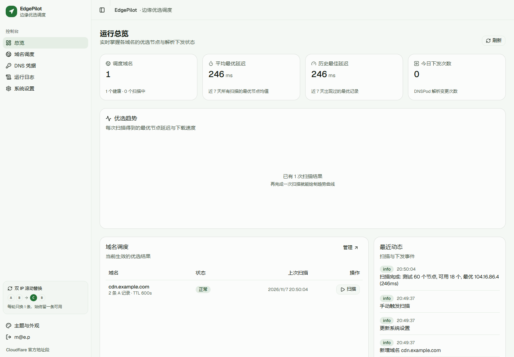
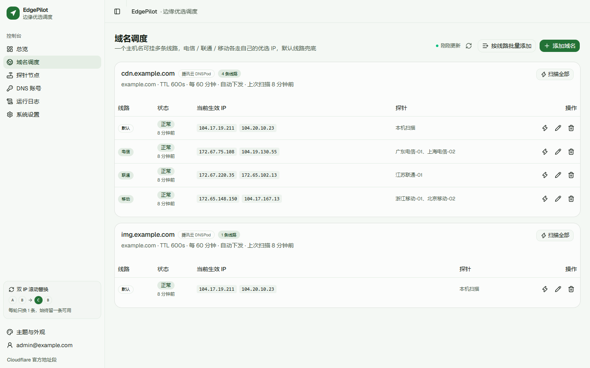
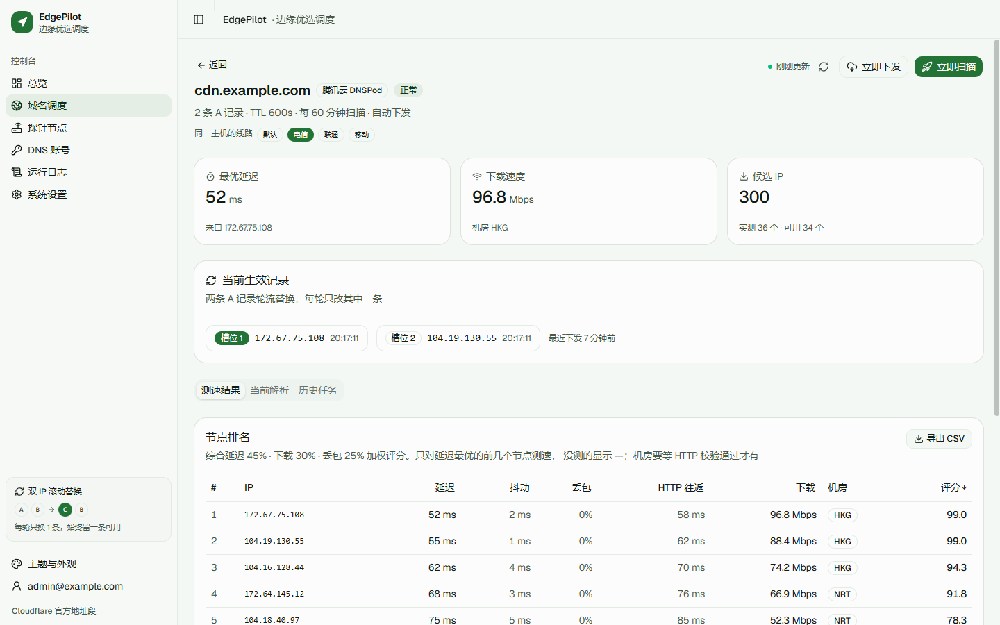
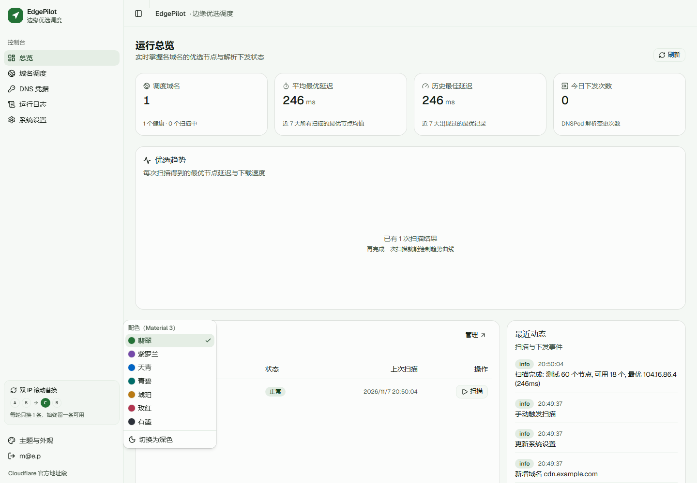
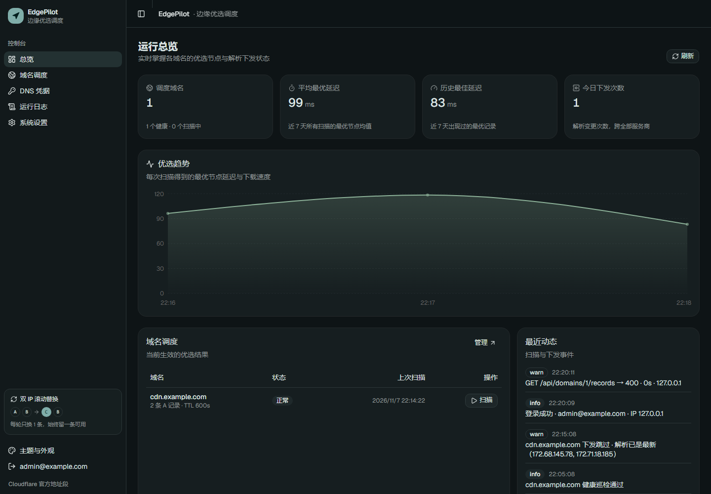
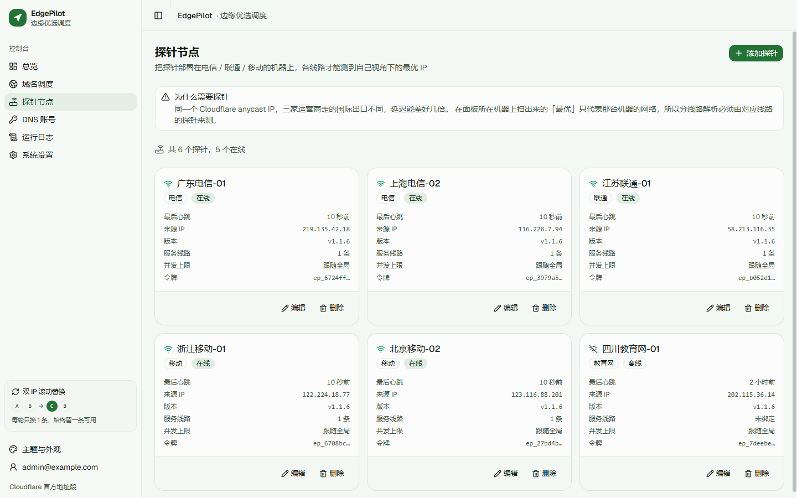
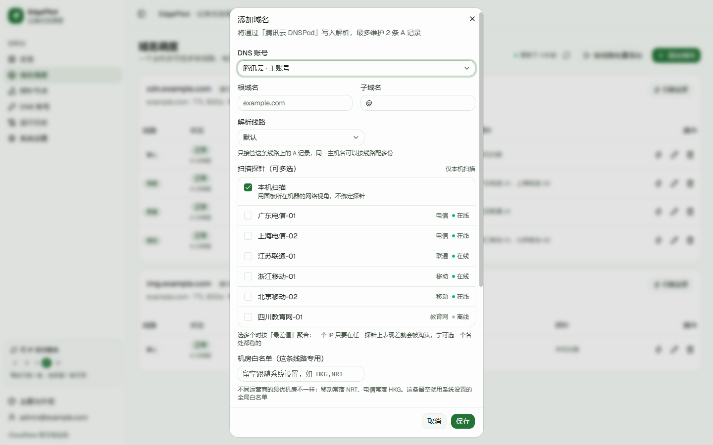
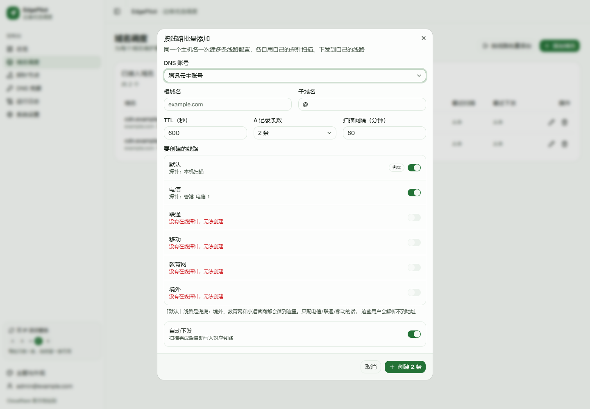

<div align="center">  
  
<h1>EdgePilot · 边缘领航</h1>  
<p>给 Cloudflare 站点挑最快的边缘 IP，挑完自动改 DNS  
一个二进制跑起来，剩下的交给它</p>  
<p>  
<a href="https://github.com/whohhnb/cf-ip-optimizer/releases"></a>  
<a href="https://github.com/whohhnb/cf-ip-optimizer/actions"></a>  
<a href="LICENSE"></a>  
  
  
</p>  
</div>

| 上手                  | 深入                          | 运维            |
| :------------------ | :-------------------------- | :------------ |
| [它解决什么问题](#它解决什么问题) | [工作原理](#工作原理)               | [部署](#部署)     |
| [特性](#特性)           | [双 IP 滚动替换](#双-ip-滚动替换)     | [配置](#配置)     |
| [快速开始](#快速开始)       | [分线路与探针](#分线路与探针)           | [忘记密码](#忘记密码) |
| [界面](#界面)           | [支持的 DNS 服务商](#支持的-dns-服务商) | [常见问题](#常见问题) |

## 它解决什么问题

Cloudflare 的 anycast 网络里，**任何一个边缘 IP 都能打开你的站**，但从国内出发，不同 IP 的路由质量能差三到十倍，同一个域名换个 IP 可能从 300ms 掉到 60ms。

社区的做法是拿测速工具扫一遍，挑几个快的，手动去 DNS 面板改 A 记录。问题是 IP 会劣化，今天快的下个月就慢，没人天天手动扫。

EdgePilot 把这套流程做成常驻服务：**定时测速 → 按延迟、速度、丢包打分 → 把最优的两个 IP 写进你的 DNS**，你只管看结果。

适合自己管着域名、想要电信联通移动都快、并且能接受一台常驻机器的人。只想改一次 IP、拿不到 DNS API 权限、或者要的是 IPv6（本项目只写 A 记录），它不是干这个的。

跑起来大概长这样：



## 特性

| 😀                                                                   | 😀                                               |
| :------------------------------------------------------------------- | :----------------------------------------------- |
| **三段式测速**<br />TCP 握手 → `/cdn-cgi/trace` 校验 → 下载测速，不拿带宽去测一堆注定不合格的 IP | **双 IP 滚动替换**<br />每轮只改一条记录，任何时刻都有一条指向可用 IP      |
| **故障自愈**<br />每三分钟巡检当前生效的 IP，全挂立刻重扫，不等定时任务                           | **只动自己的记录**<br />备注标记 + 本地「记录 ID → 槽位」账本，手写记录永不碰 |
| **16 家 DNS 服务商**<br />国内四家 + 海外主流，外加自定义 Webhook 兜底                   | **分线路 + 探针**<br />电信 / 联通 / 移动各测各的，下发到各自的线路记录    |

> [!TIP]  
> 加新厂商只要在 `backend/internal/dnsprovider/` 放一个文件，实现五个方法加一段 `Register()` 声明字段，前端表单自动出现，UI 一行都不用改。

## 快速开始

### 动手前先确认

工具只负责「测速 + 写 A 记录」，两头得自己准备好：

- **Cloudflare 侧**：域名必须已经在 CF 上生效（常规接入、CNAME 接入、SaaS 自定义主机名都行）。没生效的话把 A 记录指向 CF 边缘 IP 只会拿到 403；测速时会用你的域名做 SNI，所以证书得先签好。
- **DNS 侧**：NS 托管在你选的服务商上，账号有该域名的解析读写权限。建议单独建一个只有解析权限的子账号，别用主账号密钥。

### 三条命令

```bash
git clone https://github.com/whohhnb/cf-ip-optimizer && cd cf-ip-optimizer
cp .env.example .env      # 填 PILOT_DOMAIN、ACME_EMAIL、PILOT_SECRET
docker compose up -d --build
```

打开 `https://你的域名`，**第一个注册的账号自动成为管理员**，然后按顺序做三件事：加 DNS 账号 → 加域名 → 等它扫完。

### 其他安装方式

- **预编译包**：[Release](https://github.com/whohhnb/cf-ip-optimizer/releases) 里有 linux / macOS / Windows 五个平台的压缩包，解压即用
- **现成镜像**：不想本地构建的话，直接拉 CI 推好的多架构镜像（amd64 / arm64）

```bash
docker pull ghcr.io/whohhnb/cf-ip-optimizer:latest
```

## 界面

一个主机名一张卡，四条线路一行一条，直接看到当前生效的 IP、绑的探针和失败原因：



点进去是这条线路的扫描明细，每列可排序，能导出 CSV：



配色参照 Material Design 3，但没照抄那套四十多个 token。每套主题只声明四个种子色（primary、secondary、tertiary、error），其余 surface、border、文字色全部用 `color-mix()` 从种子算出来，浅色面是主色混白 5%，深色面是主色混近黑 8%，这就是 MD3 的 tonal surface。换主题只改四个变量，整个界面自动跟着走。

内置七套配色（默认翡翠）加明暗模式，左下角随时切：



深色模式下所有 surface 也跟着种子色走，不是简单反色：



窄屏下侧边栏自动收成图标栏，表格按优先级隐藏次要列，手机上「域名、状态、操作」永远可见，不用横向滚动才能点到操作。

## 工作原理

定时器到点就扫一轮，扫完评分、下发；平时每三分钟巡检一次当前生效的 IP，全挂就立刻重扫，不等下一个周期。

一轮扫描具体做了什么：

```
采样     官方 15 段里取 300 个：一半均分（保证小段不被淹没），一半按段大小加权
复用     上一轮评分最高的 24 个地址直接进本轮候选
前缀     配了候选前缀就先按线路展开（每段最多 3 个地址），剩下的随机采样
延迟     每个地址 3 次 TCP 握手（间隔 30ms），取中位数、抖动、丢包率
过滤     超过延迟上限的直接剔除
验证     对最快的 36 个请求 /cdn-cgi/trace，确认真能服务，拿到机房代码和 HTTP 往返
测速     对前 12 个拉固定字节数，跳过握手与慢启动后计时
评分     延迟 45% + 速度 30% + 丢包 25%，HTTP 往返异常再扣最多 15%
```

几个刻意的取舍：

**采样不做纯随机。** `104.16.0.0/13` 占官方地址空间的 34%，一个 /22 只占 0.07%，纯按大小加权的话小段在 300 个里期望只有 0.2 个，很多轮根本抽不到。所以一半预算均分给 15 个段。

**复用上一轮的结果。** anycast 下同一个客户端测 300 个随机 IP，绝大多数还是落到同一个 PoP，多抽一个随机 IP 的边际收益接近零；而一条已经验证过 87ms 的路径，价值高得多。

**下载测速跳过握手和慢启动。** 计时从响应头到达之后开始，前 1/8 字节（上限 256KB）不计时。不这么做的话，3MB 样本在快链路上会读低 20–30%，越快的节点被低估得越多。

**没通过 HTTP 校验的节点排在最后。** 它可能 403、证书不匹配或者根本不能服务你的域名，延迟数字再好看也不该抢槽位。

**取中位数而不是均值。** 跨境链路上一次 500ms 的瞬时排队就能把均值拉高一倍，而这个 IP 实际上完全可用。

权重刻意偏向延迟，优选 IP 的收益主要来自 RTT，带宽只在首屏大资源时才有感知。延迟 10ms 满分、500ms 归零，速度 50Mbps 满分，丢包线性扣分。

### 候选前缀：只决定往哪看

随机采样有个天花板。把官方 15 段拆成 5,956 个 `/24` 各测一遍（每个取 1 个地址，TCP 握手 + `/cdn-cgi/trace`），三台探针的结果是：

| 线路       | `<120ms` 的前缀 |    最快 | 主要落点                       |
| -------- | :----------: | ----: | -------------------------- |
| 电信（湖北十堰） |      8 个     |  50ms | LAX 1060 / FRA 832 / NRT 3 |
| 联通（广东河源） |    **0 个**   | 154ms | LAX 2197                   |
| 移动（广东河源） |     290 个    |  16ms | HKG 308                    |

每轮 300 个随机候选，命中 `<120ms` 前缀的期望只有 1.3 个，命中 NRT 只有 0.15 个——所以「最优」长期停在 160ms 的洛杉矶，不是评分算错了，是候选里根本没有更好的。

「设置 → 候选前缀」里可以按线路维护一份 `/24` 清单，扫描时先展开成地址（每段最多 3 个），剩下的预算仍然随机采样。

**它是配置，不是记忆。** 表里只有前缀本身，没有延迟、命中次数这些字段；只有人手导入和删除两个写入口，扫描链路里没有任何回写。测出来什么、选谁下发，仍然由当轮实测决定；清单为空时行为与旧版完全一致。

三网的好前缀**交集为 0**：同一个 `/24`，电信可能落东京、移动落香港、联通落洛杉矶。所以每条线路要各配一份，不能共用。联通那条线全表最快 154ms，配了也没有收益。

### 地址空间覆盖到哪

`cloudflare.com/ips-v4` 那 15 段（约 152 万个地址）就是「能服务任意代理主机名」的官方全集，本项目只在这里面选。

它**不是** Cloudflare 的全部 IP：`1.1.1.1` 公共 DNS 不在里面，Cloudflare 自有的 `104.28.0.0/14` 没发布，中国网络走独立的境内段，WARP / Gateway 出口另有文档。这些都不该拿来做优选，写进 A 记录要么打不开站点，要么根本不通。

## 双 IP 滚动替换

腾讯云「同一主机名 + 同一线路」最多两条 A 记录，这是硬限制，所以每条线路默认维护两条（分线路时每条线路各算各的，见下面的「分线路与探针」）。

假设现在是 `[A, B]`，这次扫出来最好的是 `[C, D]`：

```
当前     [A] [B]
            ↓ 每轮只换一条
轮次 1   [C] [B]      ← 只改槽位 1
            ↓
轮次 2   [C] [D]      ← 只改槽位 2
```

关掉滚动替换就一次改到位，收敛更快，但两条同时指向坏 IP 时会有几十秒全站不可用，默认开。

有个细节：目标 IP 已经在另一条记录上（只是槽位顺序不同）时，平台只在本地重排映射，**一次 API 调用都不发**。

### 整组覆盖型服务商

DNS 厂商的 API 分两类。逐记录型（腾讯云、阿里云、Cloudflare…）每条 A 记录有独立 ID，能精确只改一条；而华为云、deSEC、Gcore、NS1、GoDaddy、Spaceship 是**整组覆盖**——一个主机名加 A 类型只有一个记录集对象，里面放多个值。

这类厂商平台会读回整组、只替换其中一个值、再整体写回，滚动替换照样成立，详情页文案也跟着变，不会出现「两条记录轮流改」这种对不上的描述。

Webhook 模式更极端，只接收下发、不支持回读，界面上直接说「该服务商不支持回读记录」，而不是假装列表是空的。

## 分线路与探针

同一个 Cloudflare anycast IP，电信、联通、移动走的国际出口完全不同，延迟差 3–10 倍是常态。所以**一个 IP 不可能对三家都最优**，面板所在机器扫出来的「最优」只代表那台机器的网络。

要做三网都快，只有一条路：每条线路各自测量、各自下发。这需要探针。




### 哪些服务商支持分线路

只有 API 真的有「线路」概念的才行，其余 14 家写死了也没用：

| 服务商            |  支持 | 线路取值                                                            |
| -------------- | :-: | --------------------------------------------------------------- |
| 腾讯云 DNSPod     |  ✅  | 默认 / 电信 / 联通 / 移动 / 教育网 / 境外                                    |
| 阿里云云解析         |  ✅  | `default` / `telecom` / `unicom` / `mobile` / `edu` / `oversea` |
| 其余 14 家（见下方清单） |  ❌  | —                                                               |

不支持的服务商，界面上的线路选择器会直接禁用，后端也会拒绝非默认线路。**不会静默把「电信」当成「默认」写进去**，那样只会多出一条重复记录，比报错更难查。

> [!NOTE]  
> DNSPod 的权威线路清单是 `DescribeRecordLineList` 接口，具体可用线路受套餐限制。上面列的是免费版就带的基础线路，传了套餐不支持的值，API 会直接报错并原样透出。

### 怎么用

**1. 加探针**：面板「探针节点」→ 添加 → 选线路。令牌只显示一次。

**2. 在对应线路的机器上跑**（同一个二进制，不需要额外装东西）：

```bash
edgepilot probe \
  --server https://panel.example.com \
  --token ep_xxxxxxxx \
  --interval 5s
```

**3. 建域名时选线路 + 选探针**：同一个主机名建三份，`cdn` 的电信那份绑电信探针，联通那份绑联通探针，各自扫描、各自下发到自己的线路。

```
cdn.example.com  电信  → 探针「香港-电信」 → 下发到 RecordLine=电信
cdn.example.com  联通  → 探针「香港-联通」 → 下发到 RecordLine=联通
cdn.example.com  移动  → 探针「香港-移动」 → 下发到 RecordLine=移动
```

弹窗里选好线路，下面就能勾探针，线路不一致的探针会直接标红提醒：



**批量建**：「按线路批量添加」一次把默认 + 三网建好，每条线路自动匹配同线路的在线探针；没有探针的线路会直接禁用，不会拿本机去冒充联通。



### 一条线路可以绑多个探针

一个探针只代表它所在那一小块网络。广东移动的视角和北京移动差很多，只绑一个，等于拿一个省的结论推全国。

所以一条线路可以绑多个探针，结果按**最差值**合并：

```
移动线路绑 广东 / 北京 / 四川 三个探针
  ↓ 主控生成一份候选列表，同时下发给三个探针
  ↓ 每个 IP 取「三地里最差的那个延迟」
  ↓ 重算评分，选最差值最小的写进解析
```

一个 IP 在广东 30ms、北京 120ms，单探针会选它；三地聚合后它会被淘汰，换一个三地都 60ms 的。**要的是下限，不是平均。**

两个实现细节：

- **候选列表由主控统一下发**。两个探针各自随机采样 300 个，在 152 万地址里几乎不重叠，按 IP 合并就没有意义了。
- **某个探针没回来也能合并**。用已回传的结果继续，日志里标「1 / 2 个探针未返回」；一台探针掉线不会让整条线路停摆。

代价是线性的：3 个探针 = 3 份扫描流量。所以一条线路最多绑 8 个，再多收益就没了。

### 每条线路用不同的机房白名单

同一个 IP 对不同运营商会落到不同 PoP：移动常落 NRT、电信常落 HKG。系统设置里那个全局白名单只能取交集，会漏掉一部分好 IP。

所以域名配置里还有一份「机房白名单」，**留空跟随全局，填了就只对这一条线路生效**：

```
cdn.example.com  电信  → HKG          落地香港，回源 1-5ms
cdn.example.com  移动  → NRT,SIN      移动走日本/新加坡更快
cdn.example.com  联通  → HKG,NRT      联通两条路都还行，取并集
```

这条比调任何权重都有效：落在 LAX 的 IP 延迟 150ms 起，再怎么评分也救不回来。

### 每条线路仍是 2 条，但总量翻倍

腾讯云的限制是「同一主机名 + 同一线路最多两条 A 记录」，**按线路算，不是按主机名算**：

| 配置                | 总 A 记录数 |  单个访客实际拿到的  |
| ----------------- | :-----: | :---------: |
| 只有默认              |    2    |      2      |
| 默认 + 电信 + 联通 + 移动 |    8    | 2（自己线路的那两条） |

对单个访客来说可用 IP 数没变多，变多的是「每一类人各自有 2 个」。想再往上加只能靠权重（DNSPod 免费版不支持）或更细的线路。

**「默认」是兜底，必须配。** 只配电信/联通/移动时，境外、教育网、广电/鹏博士这类小运营商会落到默认线路，没有默认记录就是解析不到。

同一个主机名 + 同一条线路只允许一份配置：两份会各自以为自己在管同一组记录，每轮扫描互相覆盖。

### 几个刻意的设计

**探针离线时直接报错，不退回本机扫描。** 用错误的视角测出来的结果比没有结果更糟，它会被当成「联通最优」写进解析。

**任务超时会被回收。** 探针崩了不会把域名槽位永久占住：排队超过 5 分钟、执行超过 20 分钟的任务会被判失败，槽位释放，域名标记为错误。

**多探针按最差值合并，不是平均。** 平均值会让「一家极好、一家极差」的 IP 胜出，而这正是最差的情况——一半用户会踩坑。

**探针可以单独限并发。** 家宽路由器的 NAT 表只有几千条，48 并发 × 300 候选会把表打满，表现为丢包率虚高。探针的「并发上限」填 16–24，独立服务器留空跟随全局。这条是上限不是覆盖：填得比全局大也不会真的跑更高。

**心跳与扫描解耦。** 一次扫描可能跑几分钟，心跳是独立协程每 30 秒一次，不会因为正在扫描就被判离线。

**令牌只存哈希。** 服务端保存的是 SHA-256 摘要，明文只在创建时显示一次；数据库泄露也拿不到可用的探针凭据。

**探针回传的结果按不可信输入处理。** IP 必须是合法 IPv4（A 记录不认 v6）、去重、数值钳位、机房码只接受 3 位大写字母。

## 支持的 DNS 服务商

| 类别     | 服务商                                                                                                               |
| :----- | :---------------------------------------------------------------------------------------------------------------- |
| **国内** | 腾讯云 DNSPod · 阿里云云解析 · 华为云云解析 · 百度智能云 DNS                                                                          |
| **海外** | Cloudflare · GoDaddy · Porkbun · NameSilo · ClouDNS · deSEC · NS1 · Gcore DNS · Vercel DNS · Name.com · Spaceship |
| **兜底** | 自定义 Webhook（只下发，不回读）                                                                                              |

## 部署

### Docker

推荐，也就是上面的三分钟版本。Caddy 自动申请证书，SSE 需要关闭缓冲，`deploy/Caddyfile` 里已经配好 `flush_interval -1`。

改了代码要自己构建就用 `docker compose up -d --build`；只是跑起来的话直接拉 `ghcr.io/whohhnb/cf-ip-optimizer:latest`，amd64 / arm64 都有。

### 二进制

下载 Release 包，或者自己编：

```bash
cd web && npm ci && npm run build && cd ..
cd backend && CGO_ENABLED=0 go build -trimpath \
  -ldflags "-s -w -X edgepilot/internal/httpapi.Version=$(git describe --tags --always)" \
  -o ../dist/edgepilot .
```

必须**先编前端再编后端**，`go:embed` 把前端打进二进制，目录不存在会直接编译失败。装了 make 的话 `make build` 就是这两步。

**systemd** 的模板在 `deploy/edgepilot.service`，改掉 `WorkingDirectory`、`PILOT_DATA_DIR` 和 `PILOT_SECRET` 就能用；它跑在独立的 `edgepilot` 用户下，记得让数据目录对该用户可写。

### 反向代理与真实 IP

套了 CDN 的话，程序优先读 CDN 在边缘写入的真实 IP 头（EdgeOne 的 `EO-Connecting-IP`、Cloudflare 的 `CF-Connecting-IP`）。这比 `X-Forwarded-For` 可靠：XFF 是一条链，最右一条是「最后一跳」的地址，CDN 后面再套一层 nginx 就会取到节点 IP。

| CDN                          | 头名                   | 默认已包含 |
| ---------------------------- | -------------------- | :---: |
| 腾讯云 EdgeOne                  | `EO-Connecting-IP`   |   ✅   |
| Cloudflare                   | `CF-Connecting-IP`   |   ✅   |
| Akamai / Cloudflare 企业版      | `True-Client-IP`     |   ✅   |
| Fastly                       | `Fastly-Client-IP`   |   ✅   |
| 阿里云 CDN / 华为云 CDN / 自建 nginx | 只有 `X-Forwarded-For` |  回退逻辑 |


只给 `X-Forwarded-For` 的 CDN 要注意：如果源站前面**还有一层代理**，最右一条会是 CDN 节点地址。这种情况要么让源站直接接收 CDN 回源，要么用 CDN 提供的专用真实 IP 头（没有的话就在中间那层代理上做 `real_ip` 还原）。

> [!WARNING]  
> 前提是源站只能由 CDN 回源（安全组放行 CDN 回源段）。否则绕过 CDN 直连源站的人可以伪造这个头，和伪造 `X-Forwarded-For` 一样能绕开登录限流。

**探针**部署在电信 / 联通 / 移动的机器上，只需要能**主动访问**面板的 HTTPS 端口（出站即可，不用开入站），每 5 秒拉一次任务、每 30 秒发一次心跳。

## 配置

全部走环境变量：

| 变量                       | 默认                                                                  | 说明                                                                  |
| ------------------------ | ------------------------------------------------------------------- | ------------------------------------------------------------------- |
| `PILOT_ADDR`             | `:8080`                                                             | 监听地址                                                                |
| `PILOT_DATA_DIR`         | `./data`                                                            | 数据目录，**不会写到用户目录**                                                   |
| `PILOT_SECRET`           | 自动生成                                                                | JWT 签名加凭据加密，**定了就别改**，改了旧凭据要重填                                      |
| `PILOT_BASE_URL`         | 空                                                                   | 对外地址，决定 Cookie 要不要加 `Secure`                                        |
| `PILOT_TRUST_PROXY`      | `false`                                                             | 面板在反向代理后面时设为 `true`，否则日志与登录限流看到的是代理地址；直接对外提供服务时保持 `false`，不然这些头可被伪造 |
| `PILOT_CLIENT_IP_HEADER` | `EO-Connecting-IP,CF-Connecting-IP,True-Client-IP,Fastly-Client-IP` | CDN 写入的真实 IP 头，按顺序取第一个合法的。用其他 CDN 时按它文档里的头名改                        |
| `PILOT_LOG_LEVEL`        | `info`                                                              | 调成 `debug` 能看到每个扫描阶段和调度器巡检                                          |

> [!IMPORTANT]  
> `PILOT_SECRET` 同时用于签发登录态和加密 DNS 凭据。丢了它，已经保存的凭据就解不开，只能重新填一遍。

配置也可以写在**工作目录或可执行文件同目录**的 `.env` 里，启动时自动加载。**已存在的环境变量优先**——systemd 的 `Environment=` 和 docker 的 `-e` 依然会覆盖文件里的值。启动日志会打印实际加载了哪个文件。

## 忘记密码

密码是 bcrypt 单向哈希，看不到原文，只能重置。照 OpenList 的做法给了一条命令行兜底——不需要能登录面板，只要能在服务器上执行二进制：

```bash
# 忘了用哪个邮箱注册的
./edgepilot admin

# 随机生成一个新密码（推荐，不会留在 shell 历史里）
./edgepilot admin random

# 或者手动指定
./edgepilot admin set 'MyNewPass123'
```

数据目录不是默认位置时加 `--data`（等价于 `PILOT_DATA_DIR`）：

```bash
./edgepilot --data /opt/edgepilot/data admin random
```

Docker 部署：

```bash
docker compose exec edgepilot /app/edgepilot admin random
```

服务在跑的时候也能执行——SQLite 是 WAL 模式，支持多进程同时访问。重置会同时把该账号的 `token_version` 加一，**已经登录的浏览器立刻失效**，不会出现「密码改了但旧会话还在用」。

存在多个管理员时需要用 `--email` 指定是哪一个。

> [!NOTE]  
> 这条只针对管理员账号。普通用户忘了密码目前只能由管理员用同样的方式重置，面板里还没有对应入口。

## 常见问题

| 现象                             | 原因                                                            |
| ------------------------------ | ------------------------------------------------------------- |
| 下载速度全是 `—`                     | 服务器到 `speed.cloudflare.com` 的 TLS 被拦（企业网关或受限网络），延迟排名依然有效，忽略即可 |
| `AuthFailure.SignatureFailure` | 腾讯云密钥填错，或服务器时间偏差超过 5 分钟                                       |
| `Invalid request headers`      | Cloudflare Token 无效，或缺 Zone.DNS 编辑权限                          |
| 页面一直「扫描中」                      | 反代把 SSE 缓冲了，检查 `proxy_buffering off` 或 `flush_interval -1`    |
| 解析改了但站点没变                      | 本地 DNS 缓存，等 TTL 过期                                            |
| 凭据解密失败                         | `PILOT_SECRET` 和保存凭据时用的不是同一个，换回去或重填凭据                         |

## 开发

```bash
make build   # 前端加后端，产出 dist/edgepilot
make test    # go vet 加 go test
make fmt
```

前后端分离调试：`cd backend && go run .` 加 `cd web && npm run dev`，Vite 已配好 `/api` 代理。

**发版**：`git tag v1.0.0 && git push origin v1.0.0`。CI 跑 `go vet` 和 `go test -race`，交叉编译五个平台的压缩包，推 `linux/amd64` 加 `linux/arm64` 镜像到 ghcr，最后用自动生成的 release notes 发版；带 `-` 的 tag（如 `v1.1.0-rc1`）会标成预发布。

```
backend/
  internal/
    agent/         探针端：拉任务、跑扫描、回传结果
    dnsprovider/   16 家服务商加记录同步逻辑
    logx/          控制台与页面共用的日志出口
    scanner/       采样、探测、测速、评分
    scheduler/     定时扫描与健康巡检
    service/       扫描到下发的编排
    httpapi/       路由与处理器
    store/         SQLite
web/
  src/components/ui/   shadcn registry 组件（MIT）
  src/pages/           页面
deploy/                Caddyfile、systemd
```

## 许可

[AGPL-3.0](LICENSE) © 2026 whohhnb

自用、修改、分发都行，改完的代码同样以 AGPL-3.0 开源，**通过网络对外提供服务也算分发**。拿它做收费 SaaS 需要公开你的修改，要闭源商用联系我拿商业授权。

第三方组件的许可见 [THIRD\_PARTY\_NOTICES.md](THIRD_PARTY_NOTICES.md)。
